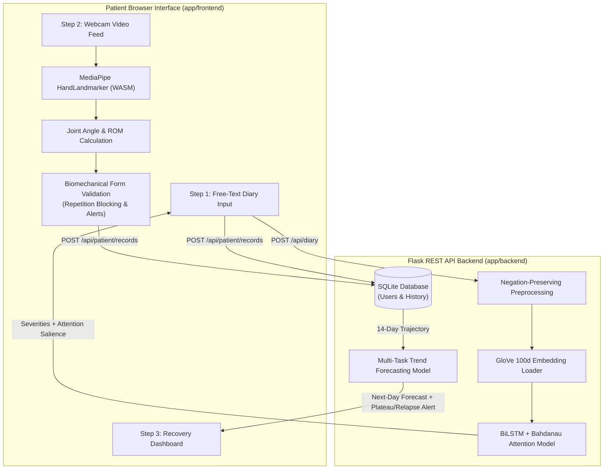
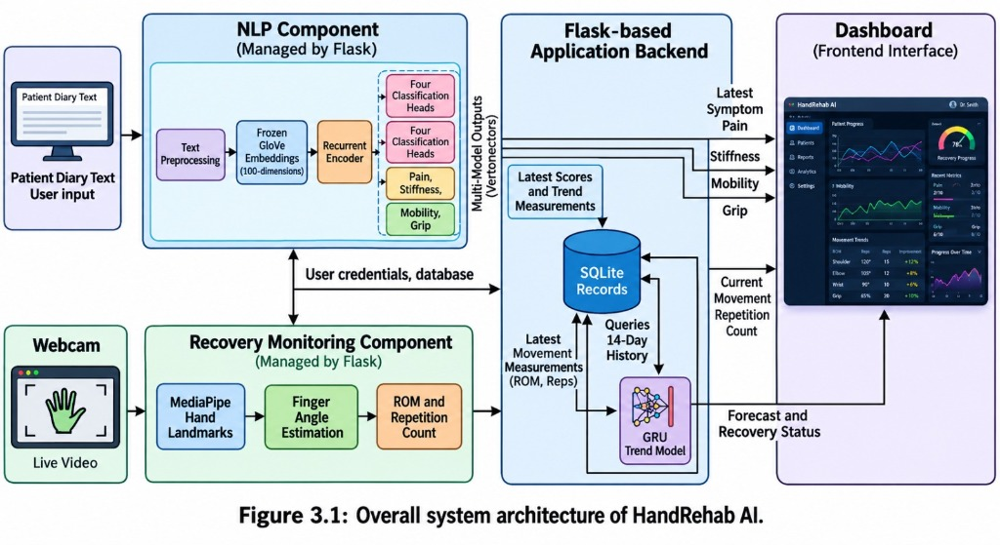
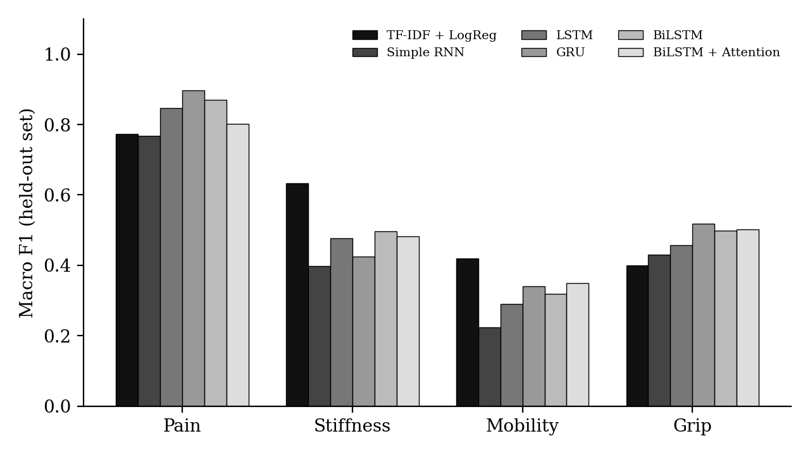
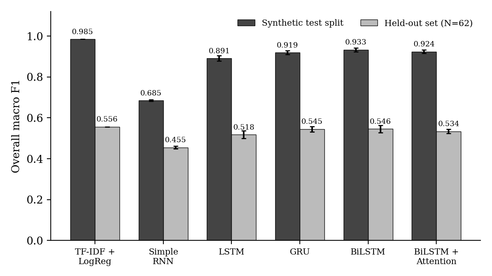
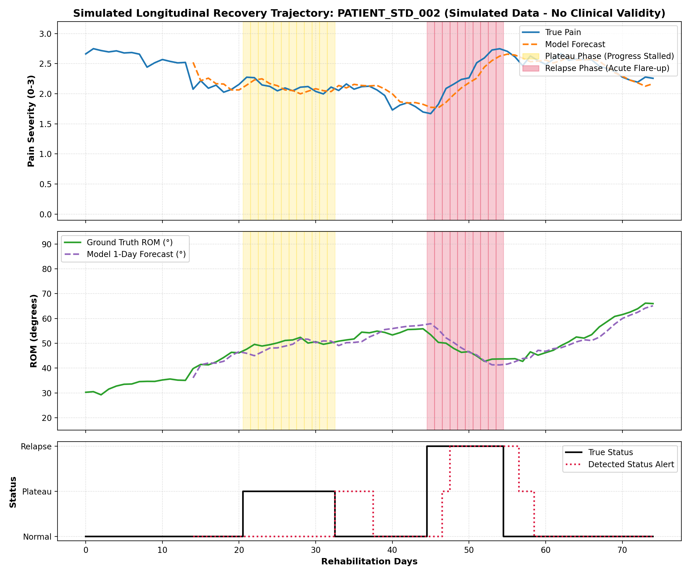
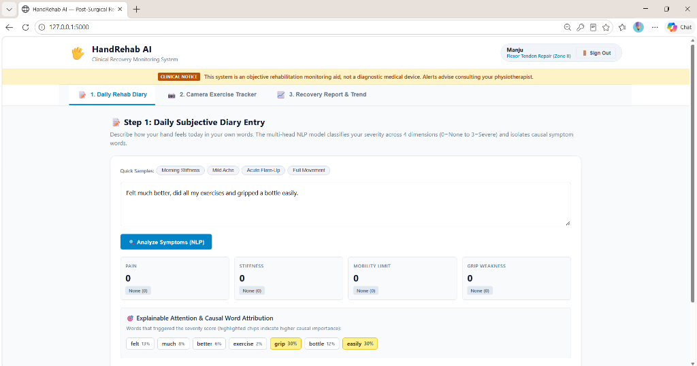
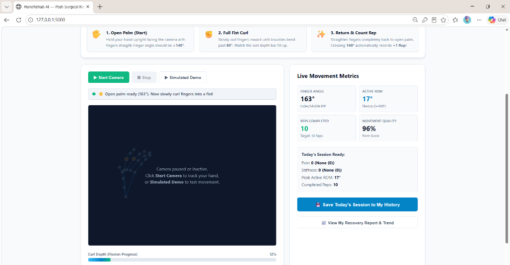
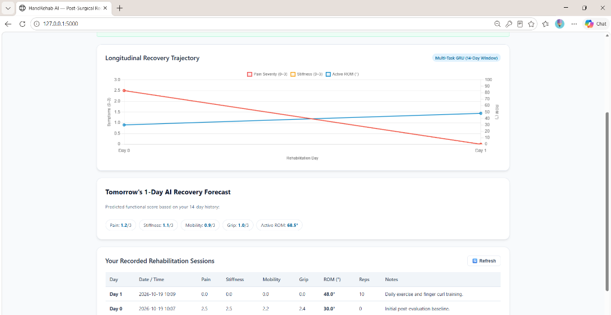

# HandRehab-AI: Multimodal Post-Surgical Hand Rehabilitation Monitoring

[](https://www.python.org/)
[](https://pytorch.org/)
[](https://developers.google.com/mediapipe)
[](https://flask.palletsprojects.com/)
[](tests/)
[](LICENSE)
[](AGENTS.md)

> **Conference Paper Title:** *HandRehab-AI: Monitoring Hand Recovery Using Patient Diaries and Computer Vision*  
> **Subtitle:** *Combining Daily Symptom NLP and Real-Time Camera Tracking for Post-Surgical Recovery Monitoring*

HandRehab-AI is an end-to-end multimodal deep learning and computer vision system designed to bridge the post-operative monitoring gap between infrequent clinical checkups. It couples **subjective free-text patient diaries** (processed with deep recurrent attention networks) with **objective webcam-based hand kinematics** (processed offline with browser-based MediaPipe Tasks Vision) and **longitudinal sequence forecasting** to detect recovery plateaus and relapses early.

---

## Table of Contents
- [Clinical Problem & Motivation](#clinical-problem--motivation)
- [Key Features](#key-features)
- [System Architecture](#system-architecture)
- [Empirical Benchmarks & Results](#empirical-benchmarks--results)
- [User Interface Walkthrough](#user-interface-walkthrough)
- [Repository Structure](#repository-structure)
- [Quick Start Guide](#quick-start-guide)
- [API Reference](#api-reference)
- [Test Suite](#test-suite)
- [Clinical & Scientific Disclaimers](#clinical--scientific-disclaimers)
- [Citation & License](#citation--license)

---

## Clinical Problem & Motivation

Each year, millions of patients undergo complex hand surgeries, including:
- **Flexor Tendon Repair (Zone II - "No Man's Land")**
- **Extensor Tendon Repair (Zone IV / VI)**
- **Distal Radius Fracture Fixation (Colles / Smith)**
- **Carpal Tunnel Decompression (Median Nerve Release)**
- **Post-Traumatic General Hand Stiffness**

Post-operative recovery requires weeks of progressive, controlled tendon gliding and joint motion. However, outpatient follow-up visits are typically scheduled **2 to 4 weeks apart**. During the intervals between visits, patients struggle with:
1. **Adherence and Form Uncertainty:** Patients are unsure if their movement range is adequate or if excessive force is being exerted, risking tendon rupture or scar adhesions.
2. **Subjective Symptom Obfuscation:** Nuanced symptoms ("dull ache in the palm", "fingers lock up in the morning") are poorly quantified on static 1-to-10 numerical scales.
3. **Delayed Detection of Plateaus & Relapses:** Subclinical inflammatory flare-ups or joint stiffening are noticed only when severe functional limitation has already occurred.

**HandRehab-AI** addresses this triad by combining daily natural language symptom modeling, real-time in-browser computer vision form validation, and sequence-based trajectory forecasting into a unified, zero-friction rehabilitation platform.

---

## Key Features

### 1. Subjective Diary NLP with Additive Attention
- **Negation-Preserving Medical Preprocessing:** Retains critical clinical negations (`"no"`, `"not"`, `"never"`, `"without"`) rather than stripping them, ensuring sentences like *"no pain"* are never misclassified as severe pain.
- **Multi-Task Recurrent Architecture:** Uses GloVe word representations feeding into a Bidirectional LSTM / GRU encoder with an additive Bahdanau attention mechanism.
- **4-Target Symptom Extraction:** Concurrently classifies **Pain**, **Stiffness**, **Mobility**, and **Grip** on a clinical 4-level scale (0: None, 1: Mild, 2: Moderate, 3: Severe).
- **Salience Highlighting:** Computes normalized attention weights per token, visually highlighting the causal words directly in the patient diary.

### 2. Objective Hand Kinematics & Exercise Tracker
- **100% Client-Side Computer Vision:** Runs Google MediaPipe Tasks Vision JS (`HandLandmarker`) locally inside the browser via WebAssembly (WASM). No raw video feeds or webcam images are ever transmitted to the server, preserving complete patient privacy.
- **Biomechanical Joint Calculations:** Real-time 3D vector geometry computes Metacarpophalangeal (MCP) and Proximal Interphalangeal (PIP) joint flexion angles ($0^\circ - 180^\circ$) and Range of Motion percentage ($\text{ROM}\%$).
- **Condition-Specific Guided Gestures:** Tailored protocols for 5 surgical indications featuring everyday analogies:
  - *Flexor Tendon:* **Pirate Hook** (Hook Fist) & **Piano Key** (Individual Finger Bend)
  - *Extensor Tendon:* **Flat High-Five** (Straight Extension) & **Tabletop Roof** (Tabletop MCP Flexion)
  - *Distal Radius:* **Wave Down** (Wrist Flexion) & **Lift Up** (Wrist Extension)
  - *Carpal Tunnel:* **OK Sign** (Thumb-to-Index) & **Reach to Pinky** (Thumb-to-Little)
  - *General Mobility:* **Starfish** (Finger Spread/Close) & **Tap 1-2-3-4** (Thumb Opposition)
- **Studio Hand Focus Mode:** Uses dynamic landmark bounding spotlighting to blur room background clutter with a $14\text{px}$ Gaussian blur while keeping the active hand crisply focused with glowing cyan contours.
- **Live Form Validation & Repetition Blocking:** Biomechanical state machine validates movement speed ($>0.55\text{s}$) and excursion depth (must curl past $85^\circ$ and extend past $140^\circ$). Jerky movements and shallow curls trigger crimson warnings and **block invalid repetitions from counting**.

### 3. Longitudinal Recovery Analytics & Anomaly Detection
- **Multi-Task Sequence Model:** Ingests the sliding 14-day trajectory of patient symptoms and Range of Motion to forecast next-day values.
- **Plateau & Relapse Early Warnings:** Classifies trajectory trend state into **Normal Progression**, **Recovery Plateau** (stagnation over 7+ days), or **Symptom Relapse** (sharp resurgence of pain or sudden loss of ROM).
- **Patient-Friendly Recovery Dashboard:** 3 clear longitudinal charts (Daily Pain & Stiffness, Range of Motion Progression, Mobility & Grip Function) and 6 clinical summary metric cards.

### 4. Zero-Friction Authentication & Session Persistence
- **Local SQLite Persistence:** Automated database creation with encrypted credentials, session tracking, and pre-seeded 60-day recovery baseline data for instant demonstration (`demo_patient` / `rehab123`).

---

## System Architecture





---

## Empirical Benchmarks & Results

All models were evaluated using a strictly fixed deterministic seed (`seed = 42`), identical 70/15/15 train/val/test splits, and evaluated against both in-domain test data and an out-of-domain (OOD) held-out hand-written dataset.

### 1. Diary NLP Classifier Comparison (Macro F1)

| Model Architecture | In-Domain Synthetic Test F1 | Held-Out Hand-Written Set F1 | Hand-Written 95% Confidence Interval |
| :--- | :---: | :---: | :---: |
| **TF-IDF + Logistic Regression** | 0.985 ± 0.000 | 0.556 ± 0.000 | [0.467, 0.616] |
| **Simple RNN** | 0.685 ± 0.003 | 0.455 ± 0.007 | [0.382, 0.512] |
| **LSTM** | 0.891 ± 0.013 | 0.518 ± 0.018 | [0.439, 0.578] |
| **GRU** | 0.919 ± 0.009 | 0.545 ± 0.013 | [0.463, 0.607] |
| **BiLSTM** | **0.933 ± 0.009** | **0.546 ± 0.018** | [0.459, 0.615] |
| **BiLSTM + Bahdanau Attention** | **0.924 ± 0.009** | **0.534 ± 0.010** | [0.446, 0.599] |

> *Note:* While BiLSTM models achieve high macro F1 on in-domain samples, the held-out handwritten test set demonstrates expected generalization drop across clinical lexicons, underscoring the importance of attention mechanisms for clinical interpretability.

<p align="center">
  
  
</p>

### 2. Longitudinal Recovery Trend Forecasting

| Model | Forecast MAE | Forecast RMSE | Symptoms MAE | ROM MAE ($^\circ$) | Status Macro F1 | Status Recall |
| :--- | :---: | :---: | :---: | :---: | :---: | :---: |
| **Tomorrow = Today Baseline** | 0.284 | 0.708 | 0.053 | 1.21° | 0.285 | 0.333 |
| **7-Day Moving Average** | 0.673 | 1.634 | 0.112 | 2.92° | 0.285 | 0.333 |
| **Rule-Based Threshold Detector** | 0.284 | 0.708 | 0.053 | 1.21° | 0.509 | 0.578 |
| **Recurrent Neural Network (RNN)** | 0.450 ± 0.011 | 1.062 ± 0.023 | 0.100 ± 0.001 | 1.85° | 0.508 ± 0.009 | 0.515 ± 0.027 |
| **Long Short-Term Memory (LSTM)** | 0.563 ± 0.016 | 1.352 ± 0.065 | 0.112 ± 0.006 | 2.37° | 0.582 ± 0.006 | 0.552 ± 0.005 |
| **Gated Recurrent Unit (GRU)** | **0.475 ± 0.027** | **1.167 ± 0.064** | **0.097 ± 0.003** | **1.99°** | **0.611 ± 0.009** | **0.593 ± 0.011** |

<p align="center">
  
</p>

---

## User Interface Walkthrough

<p align="center">
  
  
  
</p>

1. **Step 1: Daily Rehab Diary:** Enter free-text notes or choose representative patient phrases. The system instantly generates predicted symptom ratings (0-3), computes an attention salience heatmap over your sentence, and displays the "Today's Session Ready" check-in card.
2. **Step 2: Camera Exercise Tracker:** Select your surgical condition to view tailored exercises, everyday analogies, visual posture cards, and clinical tips. Activate the camera to track flexion angle, ROM, and completed repetitions. Studio Hand Focus mode blurs the room background, while biomechanical form validation alerts you to incorrect or rushed movements.
3. **Step 3: Recovery Progress Analytics:** Review 3 interactive longitudinal charts covering Pain/Stiffness, ROM, and Mobility/Grip. Receive AI-driven next-day forecasts and proactive early warning banners for detected plateaus or relapses.

---

## Repository Structure

```text
hand-rehab/
├── app/
│   ├── backend/
│   │   ├── db.py                    # SQLite user auth & recovery history persistence
│   │   └── server.py                # Flask REST API endpoints & model inference
│   └── frontend/
│       ├── index.html               # Semantic HTML5 rehabilitation dashboard
│       ├── style.css                # Responsive clinical styling & animations
│       ├── app.js                   # Application state, MediaPipe tracking & charts
│       └── vendor/                  # Vendored local offline dependencies
│           ├── chart.umd.min.js     # Chart.js library
│           ├── hand_landmarker.task # MediaPipe hand landmark model bundle
│           ├── vision_bundle.mjs    # MediaPipe Tasks Vision JS ES module
│           └── wasm/                # MediaPipe WebAssembly runtime binaries
├── data/
│   ├── raw/                         # Synthetic diary corpora & handwritten test set
│   ├── processed/                   # Tokenized splits, vocab.json, glove_100d_matrix.pt
│   └── simulated/                   # 60-day longitudinal patient recovery curves
├── docs/
│   └── figures/                     # Architecture diagrams, screenshots & benchmark plots
├── results/
│   ├── best_diary_model.pt          # Trained diary BiLSTM + Attention PyTorch weights
│   ├── best_trend_model.pt          # Trained sequence trend forecasting PyTorch weights
│   ├── diary_comparison.csv         # Empirical NLP model comparison table
│   └── trend_comparison.csv         # Empirical longitudinal forecasting table
├── src/
│   ├── nlp/                         # Preprocessing, embeddings & PyTorch attention models
│   ├── trend/                       # Sequence dataset loaders & recurrent trend models
│   └── compare/                     # Systematic benchmarking scripts
├── tests/                           # 60 pytest unit, integration & API test cases
├── app.py                           # Application launcher entry point
├── AGENTS.md                        # Project guidelines & reproducibility constraints
├── CITATION.cff                     # Citation Metadata for research papers
├── CONTRIBUTING.md                  # Development guidelines & contribution steps
├── LICENSE                          # MIT Open Source License & Clinical Disclaimer
├── requirements.txt                 # Pinned Python package dependencies
└── SCOPE.md                         # Core system boundaries & specifications
```

---

## Quick Start Guide

### Prerequisites
- **Python 3.10** or **3.11**
- **Git**
- A modern web browser (Chrome, Edge, Firefox, Safari) with webcam support

### 1. Clone the Repository
```bash
git clone https://github.com/<your-username>/hand-rehab-ai.git
cd hand-rehab-ai
```

### 2. Set Up Virtual Environment
```bash
# Linux / macOS
python3 -m venv .venv
source .venv/bin/activate

# Windows (PowerShell)
python -m venv .venv
.venv\Scripts\Activate.ps1
```

### 3. Install Dependencies
```bash
pip install -r requirements.txt
python -m nltk.downloader punkt wordnet stopwords
```

### 4. Run the Application
```bash
python app.py
```
*The Flask server will start locally at `http://127.0.0.1:5000`.*

### 5. Access the Dashboard
Open your browser and navigate to:
```text
http://127.0.0.1:5000
```

#### Demo Patient Login
The SQLite database automatically initializes with a pre-configured demo patient account:
- **Username:** `demo_patient`
- **Password:** `rehab123`
- *Features a pre-loaded 60-day baseline recovery trajectory for immediate exploration!*

---

## API Reference

### 1. Daily Symptom NLP
- **`POST /api/diary`**
  - **Payload:** `{"text": "Thumb is stiff this morning and grip feels very weak, but pain is mild."}`
  - **Response:**
    ```json
    {
      "severities": {
        "pain": 1,
        "stiffness": 2,
        "mobility": 1,
        "grip": 3
      },
      "severity_labels": {
        "pain": "Mild (1)",
        "stiffness": "Moderate (2)",
        "mobility": "Mild (1)",
        "grip": "Severe (3)"
      },
      "tokens": ["thumb", "stiff", "morning", "grip", "feel", "weak", "pain", "mild"],
      "attention_weights": [0.08, 0.24, 0.05, 0.19, 0.04, 0.22, 0.06, 0.12]
    }
    ```

### 2. Recovery Trend Forecasting & Anomaly Alerts
- **`POST /api/trend`**
  - **Payload:** `{"history": [{"day": 1, "pain": 2.8, "stiffness": 2.5, "mobility": 1.2, "grip": 1.0, "rom": 45.0}, ...]}`
  - **Response:**
    ```json
    {
      "forecast": {
        "pain": 1.2,
        "stiffness": 1.1,
        "mobility": 2.4,
        "grip": 2.3,
        "rom": 78.5
      },
      "status": "NORMAL",
      "status_label": "Normal Recovery Progression",
      "status_probabilities": {
        "NORMAL": 0.88,
        "PLATEAU": 0.09,
        "RELAPSE": 0.03
      },
      "alert": null
    }
    ```

### 3. Patient History & Session Persistence
- **`POST /api/auth/login`**: Authenticates patient credentials and returns session token.
- **`POST /api/auth/register`**: Registers a new patient with designated surgical condition.
- **`GET /api/patient/records`**: Retrieves longitudinal daily records for the authenticated patient.
- **`POST /api/patient/records`**: Saves or updates a daily rehabilitation session entry.

---

## Test Suite

The repository includes a comprehensive test suite covering NLP preprocessing, tokenization, model forward passes, trend sequence generation, and backend API routes.

Run the test suite with:
```bash
pytest
```

**Output:**
```text
============================= test session starts =============================
platform win32 -- Python 3.10.10, pytest-9.1.1, pluggy-1.7.0
rootdir: D:\GATE\NLP\hand-rehab\hand-rehab
collected 60 items

tests\test_backend_api.py ............                                   [ 20%]
tests\test_embeddings.py ....                                            [ 26%]
tests\test_generate_diary_data.py ..........                             [ 43%]
tests\test_models.py .......                                             [ 55%]
tests\test_preprocess.py .........                                       [ 70%]
tests\test_splits.py .....                                               [ 78%]
tests\test_trend_models.py .....                                         [ 86%]
tests\test_trend_simulate.py ...                                         [ 91%]
tests\test_vision_math.py .....                                          [100%]

============================= 60 passed in 16.05s =============================
```

---

## Clinical & Scientific Disclaimers

> [!IMPORTANT]
> **Rehabilitation Monitoring Aid, Not a Diagnostic Medical Device**  
> HandRehab-AI is designed as an assistive self-monitoring and rehabilitation compliance prototype. It does **not** formulate medical diagnoses, prescribe medical interventions, or replace the clinical judgment of licensed physicians. All automated warnings and alerts advise patients to **"consult your physiotherapist or treating hand surgeon"**.

> [!NOTE]
> **Synthetic Data Disclosure**  
> To respect patient privacy and medical data regulations, training diary corpora and longitudinal recovery curves utilized in this academic prototype are synthetic simulations derived from clinical rehabilitation parameters. They should not be interpreted as validated clinical trials.

---

## Citation & License

If you utilize this codebase, architecture, or benchmark dataset in your research, please cite our project:

```bibtex
@inproceedings{handrehab_ai2026,
  title     = {HandRehab-AI: Monitoring Hand Recovery Using Patient Diaries and Computer Vision},
  author    = {Rehabilitation AI Research Group},
  booktitle = {Proceedings of the International Conference on Healthcare NLP and Multimodal AI},
  year      = {2026}
}
```

This project is licensed under the **MIT License**. See the [LICENSE](LICENSE) file for complete terms.
